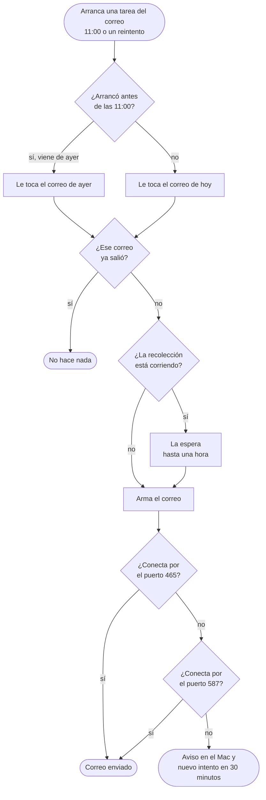

# Historia y decisiones del proyecto

Este documento cuenta cómo construimos el monitor, qué cambiamos durante la semana oficial y por qué. En cada decisión dejamos el problema que la motivó, las opciones que pusimos sobre la mesa, lo que escogimos y cómo comprobamos que funcionaba. El [README](README.md) explica cómo funciona el sistema hoy, [CAMBIOS.md](CAMBIOS.md) lista lo que trae cada versión y [docs/incidentes.md](docs/incidentes.md) registra lo que falló en el periodo.

## Línea de tiempo

| Fecha | Qué pasó | Qué hicimos |
|---|---|---|
| 9 de noviembre | Primer prototipo, con GitHub Actions y un agente de IA dentro del proceso diario | Lo descartamos (decisión 1) |
| 14 de noviembre | Rehicimos el proyecto desde cero como un programa de Python que corre en el Mac | Versión 1.0 |
| 16 de noviembre | Empezó el periodo oficial y el monitor todavía no estaba instalado | Ese día se perdió y quedó anotado como incidente |
| 17 de noviembre | Instalamos el monitor y lanzamos la primera recolección oficial con launchd | Desde ese día corre solo |
| 18 de noviembre | La recolección tardó dos horas porque se cerró la tapa del Mac, y el correo de las 11:00 no salió porque la red del trabajo bloquea el puerto 465 | Enviamos el correo a mano a las 19:23 por el puerto 587 y preparamos la versión 1.1 (decisiones 6 y 7) |
| 18 de noviembre | Decidimos responder a la sugerencia del profesor de comparar más modelos y marcas | Agregamos el Mazda 3 y el Kia K3 a la versión 1.1 (decisión 8) |

Desde el 19 de noviembre corre la versión 1.1.

## Decisiones de la versión 1.0

### 1. Un programa de Python que corre solo en el Mac, sin IA en el proceso diario

**Problema.** El monitor tenía que correr sin nadie al frente, a las 8:00 y a las 11:00, durante seis días seguidos.

**Opciones.**
* GitHub Actions, que fue nuestro primer prototipo. No depende de un computador propio, pero la búsqueda sale desde servidores de la nube y no desde una conexión de hogar, y GitHub advierte que sus tareas programadas pueden retrasarse cuando hay mucha carga. Nosotros teníamos horas fijas.
* Un agente de IA que hiciera la recolección y el análisis cada día. Agrega costo, suma una forma más de fallar en algo que debe correr solo, y una regla estadística se explica mejor en la sustentación que la opinión de un modelo.
* Un programa de Python que el Mac ejecuta con launchd, el programador de tareas que trae macOS. Es la que escogimos.

**Por qué.** El enunciado permite programar la ejecución en el propio computador, no cuesta nada, abre Carroya desde una conexión normal y nos deja ver todo lo que pasa en los logs. El agente de programación (Claude y Antigravity) lo usamos para construir, revisar y explicar el código, no para correrlo.

**Lo que cuesta.** Todo depende de que el Mac esté encendido, conectado y con la tapa abierta. Eso fue justo lo que falló el 18 (decisión 7).

### 2. Leer Carroya con un navegador real

Carroya arma sus páginas con JavaScript, así que con `requests` y BeautifulSoup el HTML llega sin anuncios. Llamar directamente la API interna del sitio habría exigido imitar sus encabezados, y preferimos no hacerlo. Por eso el programa abre con Playwright la misma página pública que vería una persona y se queda con la respuesta JSON que la página recibe. Abre una página a la vez, con pausas de 1,5 a 3,5 segundos, sin descargar fotos, y el robots.txt de Carroya permite esas rutas.

### 3. Identificador, almacenamiento y actualización

* **Identificador.** Usamos el UUID que Carroya pone al final de la dirección de cada anuncio. La dirección completa no sirve, porque incluye la ciudad y el año y el vendedor puede editarlos sin que deje de ser el mismo anuncio.
* **Almacenamiento.** Escogimos SQLite frente a un CSV acumulado y a Parquet. Es un solo archivo, viene con Python, tiene llaves que impiden duplicados y transacciones que protegen la base si el proceso se cae. La comparación completa está en el README.
* **Actualización.** `procesar_dia` guarda una observación por anuncio y día y registra cada cambio de precio o kilometraje. Es idempotente, así que procesar dos veces el mismo día no duplica nada.
* **Disponibilidad.** Que un anuncio no aparezca no prueba que se haya vendido. Por eso distinguimos entre encontrado, no encontrado en una búsqueda completa y desconocida cuando la búsqueda tuvo errores.

### 4. Cómo detectamos posibles gangas

Cada precio se compara con dos referencias. La primera es el precio esperado según un modelo de precios (regresión del logaritmo del precio contra año, kilometraje y grupo de versión) estimado con los anuncios del mismo día. La segunda es la mediana de hasta seis anuncios parecidos. Un anuncio es posible ganga solo si cumple tres condiciones a la vez, para que una sola señal no baste. Los umbrales (12 %, puntaje z de menos dos y 8 %) son decisiones razonables, no valores óptimos, y lo decimos así en el correo y en el README.

### 5. Modo prueba y modo oficial según la fecha

Las tareas del Mac deciden el modo por la fecha. Antes del 16 todo es prueba, del 16 al 21 es oficial y después del 21 no hacen nada. Así la misma programación servía para la prueba previa y para la semana oficial sin tocar nada, y las pruebas a mano nunca se mezclan con las evidencias.

## Decisiones de la versión 1.1 (18 de noviembre)

### 6. El correo que no salió

**Qué vimos.** El correo de las 11:00 (log `COR-20261118-110005`) terminó en `ConnectionRefusedError` y la etapa duró 341 segundos. Un intento a mano a las 13:51 falló igual. A las 19:23 lo enviamos a mano por el puerto 587 y salió en el primer intento (`COR-20261118-192319`).

**Diagnóstico.** El problema era de red y no de la cuenta ni del código. El error era de conexión rechazada, no de contraseña, y el mismo correo salió después por otro puerto. La red del trabajo no deja conectar al puerto 465 de Gmail. Los 341 segundos eran el programa esperando cinco minutos a que ese puerto respondiera.

**Opciones.**
* Dejar fijo el puerto 587. Resolvía este caso, pero en otra red podría pasar lo contrario.
* Enviar con la API de Gmail por HTTPS, que casi ninguna red bloquea. Exigía configurar permisos de Google en plena semana oficial.
* Probar los dos puertos y, si ninguno sirve, volver a intentar más tarde sin repetir el correo. Es la que escogimos.

**Qué cambiamos.**
* El envío prueba el 465 y, si la red no deja conectar, el 587. Un error de contraseña no cambia de puerto, porque no es un problema de red.
* La espera de conexión acepta cualquiera de los dos puertos, así ya no se pierden cinco minutos.
* Una tercera tarea de launchd intenta el correo cada 30 minutos de 11:30 a 23:30, pero solo lo envía si el del día no ha salido.
* Nunca salen dos correos del mismo día. Antes de enviar, el programa busca en los logs un correo ya enviado con la misma fecha de reporte, y un candado de archivo impide que dos tareas envíen al mismo tiempo.

### 7. La tapa cerrada y el Mac dormido

**Qué vimos.** La recolección del 18 arrancó a las 8:00 y terminó cerca de dos horas después, porque la tapa se cerró y el Mac se durmió a mitad de camino. `caffeinate` evita que el Mac se duerma por inactividad, pero no puede impedir que se duerma al cerrar la tapa.

**Qué cambiamos.**
* Avisos en la pantalla del Mac cuando empieza la recolección (no cerrar la tapa) y cuando termina (ya se puede cerrar), y uno si el correo no pudo salir.
* Cuando el Mac se despierta tarde, launchd lanza a la vez las tareas que se perdió. Para que el correo no salga con la recolección a medias, la recolección deja tomado un candado mientras trabaja y el correo la espera hasta una hora.
* Si una tarea del correo arranca antes de las 11:00, viene del horario del día anterior. En ese caso envía el correo de ayer, solo si no había salido, en lugar de mandar uno de hoy sin datos.

**Lo que no resuelve.** Si el Mac pasa el día cerrado, la recolección corre cuando se abra y queda registrada con su hora real. La regla sigue siendo dejar la tapa abierta mientras recolecta.

### 8. Comparar con otros modelos

**Contexto.** El profesor sugirió comparar más modelos y marcas, y el taller evalúa la comparación entre vehículos.

**Opciones.**
* Otros portales con los mismos carros. Cada portal necesita su propio lector y sus propias pruebas, y en plena semana oficial era mucho riesgo.
* Otros modelos en Carroya, con el lector que ya estaba probado. Es la que escogimos.

**Qué modelos.** El Mazda 3 y el Kia K3, sedanes compactos que compiten con el Corolla, en el mismo rango de años (2022 a 2026).

**Cómo los buscamos.** Primero pensamos en leer la página de toda la marca y quedarnos con el modelo. Al revisar Carroya en el navegador vimos que la marca Mazda tenía 676 anuncios en 34 páginas, contra 100 anuncios en 5 páginas en la página del Mazda 3. Usamos la página de cada modelo, con el mismo formato de dirección que la del Corolla. Recorrer menos páginas es más rápido y le pide menos al sitio.

**Cómo los separamos del Corolla.**
* Cada modelo tiene su carpeta, `datos/modelos/<modelo>/<modo>/`, y su propia base (`mazda_3.sqlite` y `kia_k3.sqlite`). Así nunca se mezclan con las evidencias oficiales del Corolla.
* Cada carro se compara solo con anuncios de su mismo modelo, con el mismo método de gangas.
* Los niveles de versión cambian por marca (Prime, Touring y Grand Touring en Mazda, y GT Line, Zenith y Vibrant en Kia), así que el programa también los reconoce.
* Corren después del Corolla y, si uno falla, no afecta al Corolla ni al otro modelo.
* El correo los muestra en una sección aparte, al final.

**Cómo lo comprobamos.** `python taller.py probar-modelos` en el Mac reconoció como Mazda 3 los 60 anuncios de las tres primeras páginas y como Kia K3 los 38 anuncios de su búsqueda, sin descartar ninguno.

### 9. Un error que encontramos revisando

La misma noche, al revisar la salida del Mac, vimos que la regla de no repetir el correo identificaba el correo enviado por la fecha del nombre del archivo de log. Esa es la fecha en que corrió, no la del reporte. Si algún día el correo saliera al día siguiente, se habría confundido con el correo de ese nuevo día y lo habría bloqueado. Lo corregimos antes de que pasara (commit `a0c0105`) y agregamos una prueba para ese caso.

## Cómo decide hoy la tarea del correo

El mismo diagrama está en `docs/flujo_correo.png` para usarlo fuera de GitHub.

## Cómo usamos el agente de programación

* Claude escribió el código a partir del enunciado y de nuestras decisiones, por ejemplo qué modelos agregar y quedarnos solo con Carroya.
* Cada cambio llega con pruebas automáticas. Hoy son 113 y corren sin internet con `python -m pytest -q`.
* Antes de dar un cambio por bueno lo probamos en el Mac (`probar-modelos`, `programar` y `estado-programacion`) y revisamos la salida. Así encontramos el error de la decisión 9.
* Cada cambio queda en un commit que explica qué cambió y por qué. Los cambios grandes quedan además en [CAMBIOS.md](CAMBIOS.md) y en este documento.
* Antigravity lee las reglas de [AGENTS.md](AGENTS.md), por ejemplo no tocar `datos/oficial`, correr las pruebas después de cada cambio y anotar aquí las decisiones nuevas.

## Lo que sabemos que falta

* El monitor depende de que el Mac esté encendido y con la tapa abierta. Con más tiempo lo pondríamos en un computador que no se mueva de su sitio.
* El correo depende de que la red deje salir SMTP. La API de Gmail por HTTPS evitaría ese problema.
* El 16 de noviembre no tiene datos.
* El Mazda 3 y el Kia K3 tienen datos desde el 19 de noviembre. El Kia K3 tiene unos 38 anuncios, así que sus alertas son menos sólidas que las del Corolla.
* Los umbrales de la regla de gangas son razonables, no óptimos.
