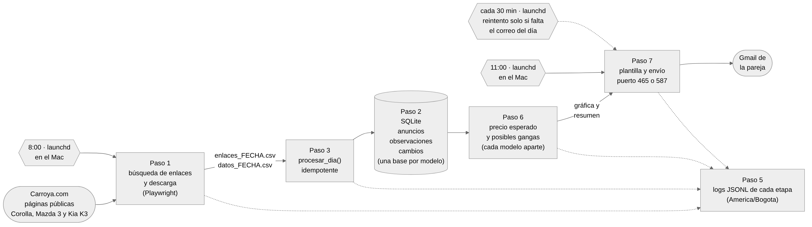

# Monitor de Toyota Corolla en Carroya

Taller 2 del Taller de Programación Aplicada en Python. El programa consulta todos los días los anuncios de Toyota Corolla modelo 2022 a 2026 publicados en Carroya, guarda lo que encuentra, lo consolida en una base de datos con historial, busca posibles gangas y envía un correo con el resumen. Corre del 16 al 21 de noviembre de 2026 en un Mac, con la recolección a las 8:00 a. m. y el correo a las 11:00 a. m., hora de Colombia. Desde el 19 de noviembre sigue además, con el mismo método y por separado, el Mazda 3 y el Kia K3 (ver [Modelos adicionales](#modelos-adicionales-mazda-3-y-kia-k3)).

**Para instalarlo y usarlo, siga [GUIA_PASO_A_PASO.md](GUIA_PASO_A_PASO.md).** Este README explica cómo funciona y por qué se tomó cada decisión.

## Cómo se desarrolló

El enunciado pide usar un coding agent para desarrollar la solución y poder explicar las decisiones. La primera versión del código la escribió Claude y la pareja la revisa, la ejecuta y la ajusta con Antigravity, que lee las reglas del proyecto en [AGENTS.md](AGENTS.md) y tiene tres habilidades propias en `.agents/skills` (revisar el día, explicar un paso y preparar la entrega). El proceso diario no depende de ningún agente. Es un pipeline de Python que el Mac ejecuta solo con launchd, como permite el enunciado.

## Arquitectura



| Paso del taller | Archivo | Qué hace |
|---|---|---|
| 1. Enlaces y datos (20 %) | `corolla/paso1_navegador.py` | Abre las páginas públicas de Carroya con Chromium y entrega el JSON que la página recibe |
| | `corolla/paso1_extraccion.py` | Convierte ese JSON en filas limpias, sin inventar datos faltantes |
| | `corolla/paso1_recoleccion.py` | Recorre todas las páginas, descarga cada ficha y escribe los archivos diarios |
| 2. Base consolidada (15 %) | `corolla/paso2_base_de_datos.py` y `consultas.sql` | Tablas SQLite, identificador estable y consultas |
| 3. Actualización (10 %) | `corolla/paso3_actualizacion.py` | `procesar_dia()`, idempotente |
| 4. Automatización (10 %) | `corolla/paso4_programacion.py` | Las tres tareas de launchd (8:00, 11:00 y reintentos del correo) |
| 5. Logs (10 %) | `corolla/paso5_bitacora.py` y `corolla/estado.py` | Logs por etapa y estado del día |
| 6. Precios y gangas (20 %) | `corolla/paso6_analisis.py` y `corolla/paso6_grafica.py` | Distribución, modelo de precios y alertas explicadas |
| 7. Correo (5 %) | `corolla/paso7_correo.py` y `corolla/plantillas/correo.html` | Plantilla y envío |
| 8. Entrega (10 %) | `corolla/paso8_entrega.py` | Exportaciones y zip para Bloque Neón |
| Todo junto | `corolla/flujo.py`, `taller.py` y `corolla/avisos.py` | Orquestación, comandos y avisos en la pantalla del Mac |
| Pruebas | `corolla/simulacion.py` y `tests/` | Carroya simulado, pruebas y demostración sin internet |

## Comandos

Todo se hace con `python taller.py <comando>`. Los comandos manuales trabajan en modo prueba (`datos/prueba`) salvo que se escriba `--modo oficial`. Las tareas del Mac usan `--programado`, que elige el modo según la fecha.

| Comando | Para qué |
|---|---|
| `verificar` | Revisa la instalación, el `.env`, la carpeta, la zona horaria y los ajustes de energía del Mac |
| `demo` | Seis días simulados sin internet, en `datos/demo` |
| `probar-correo` | Envía un correo corto para comprobar la cuenta |
| `paso1` | Busca y descarga en Carroya (`--max-anuncios 5` para una prueba rápida, `--visible` para ver el navegador) |
| `paso3` | Procesa los archivos del día en la base |
| `consultar` | Muestra las consultas del paso 2 |
| `paso6` | Distribución de precios, gráfica y posibles gangas |
| `paso7` | Arma y envía el correo (`--sin-enviar` solo guarda la copia) |
| `log` | Resumen de los logs de un día, también de los modelos adicionales |
| `recolectar` | Lo de las 8:00, pasos 1, 3 y 6 del Corolla y después de los modelos adicionales (`--solo-corolla` los omite) |
| `correo` | Lo de las 11:00, paso 7. Con `--programado` no repite un correo que ya salió |
| `modelos` | Pasos 1, 3 y 6 solo de los modelos adicionales |
| `probar-modelos` | Lee las primeras páginas de cada modelo adicional y muestra qué anuncios reconoce |
| `programar`, `estado-programacion`, `probar-programacion`, `desprogramar` | Tareas del Mac (recolección, correo y reintentos del correo) |
| `reconstruir` | Rehace la base desde los archivos diarios |
| `exportar` | Base en CSV y Excel y log consolidado |
| `entregar` | Arma `entrega_taller2_corolla.zip` y dice qué falta |

## Cómo se obtienen los datos de Carroya

Carroya es una aplicación de JavaScript. El HTML que entrega el servidor llega sin anuncios y es la página, ya abierta en el navegador, la que los pide a su API interna. Con `requests` y BeautifulSoup no se ve ningún anuncio, por eso el proyecto usa Playwright con Chromium.

El navegador abre las mismas páginas públicas que abriría una persona y el programa se queda con la respuesta JSON que la propia página recibe. En la búsqueda esa respuesta es `find-filters`, que trae el total de anuncios (`count`), el número de páginas (`pages`) y veinte anuncios por página. En cada ficha es `find-vehicle-detail`, con precio, kilometraje, versión, caja, combustible, ciudad y accesorios. Así no se inventan encabezados ni credenciales, los datos llegan estructurados en lugar de rasparlos del texto y, si Carroya cambia detalles internos de la petición, el navegador los sigue resolviendo.

Para no cargar el sitio se abre una página a la vez, con pausas de 1,5 a 3,5 segundos, y se bloquean fotos, videos y fuentes. El robots.txt de Carroya permite estas rutas. No se guarda ningún dato personal del vendedor (nombre, teléfono, correo, dirección ni placa). Los comentarios del vendedor se leen solo para detectar si menciona sunroof y no se guardan.

Si el navegador invisible no logra leer la primera página, el programa repite el paso 1 con una ventana visible de Chromium. Con `NAVEGADOR_VISIBLE=1` en el `.env` se usa siempre la ventana visible.

## Paso 1. Archivos diarios

Cada día quedan en `datos/<modo>/diarios/` tres archivos.

**`enlaces_AAAA-MM-DD.csv`**, un enlace por fila y sin repetir.

| Columna | Contenido |
|---|---|
| `id_anuncio` | Identificador estable del anuncio (UUID de Carroya) |
| `url` | Ficha pública del anuncio |
| `pagina_busqueda` | Página de resultados en la que apareció |
| `fecha_hora_descubrimiento` | Momento en que se encontró en la búsqueda de ese día |
| `es_nuevo` | True si el sistema nunca lo había visto |
| `estado_descarga` | `sin intentar`, `descargado` o `fallido` |
| `fecha_hora_ultimo_intento` | Vacía si está sin intentar |
| `intentos` y `motivo_error` | Cuántas veces se intentó y por qué falló |

**`datos_AAAA-MM-DD.csv`** es la entrada de la consolidación. Trae identificador, enlace, estado, fecha y hora de descarga y motivo del error, más los campos del vehículo con mínimo procesamiento (marca, línea, año, versión, precio, moneda, kilometraje, transmisión, ciudad, sunroof, combustible, color, cilindraje, estado de publicación y accesorios). Los anuncios fallidos o pendientes aparecen igual, con los campos del vehículo vacíos.

**`manifiesto_AAAA-MM-DD.json`** resume la búsqueda. Dice cuántos anuncios reportó Carroya, qué páginas se leyeron y cuáles fallaron, qué anuncios se descartaron por no cumplir los criterios y si la búsqueda fue completa.

Cómo se cuida la cobertura y la calidad de los datos.

* Se lee la primera página para saber cuántas hay y luego se recorren todas.
* Cada página y cada ficha tienen hasta tres intentos. Las páginas que fallan tienen otra oportunidad al final.
* Si se vieron menos anuncios de los que Carroya reporta (alguno pudo saltar de página mientras se recorría), se hace una segunda pasada completa.
* Cada anuncio se verifica contra los criterios (Toyota, Corolla, 2022 a 2026). Un Corolla Cross o un año fuera de rango se descarta y queda anotado en el manifiesto.
* Si un dato no aparece queda vacío. No se inventa ni se convierte en cero.
* La moneda viene en el resultado de búsqueda y no en la ficha, así que se toma de ahí.
* El sunroof tiene tres valores. Es True si aparece en accesorios, versión, título o comentarios, False si el vendedor llenó la lista de accesorios y no lo incluyó, y vacío si no hay información.
* Los archivos se escriben de forma atómica y se guardan cada diez descargas, así un corte a mitad de camino no deja archivos dañados.
* Si un día se vuelve a ejecutar, los archivos anteriores se mueven a `diarios/reemplazados/` en lugar de borrarse.
* En `datos/<modo>/crudos/` quedan las respuestas originales, sin datos personales, para poder reprocesar si hiciera falta.

## Paso 2. Base consolidada

La base es un archivo SQLite en `datos/<modo>/consolidado/corolla.sqlite`.

| Tabla | Una fila por | Para qué |
|---|---|---|
| `observaciones` | anuncio y día | El historial. Disponibilidad, estado y hora de la descarga y datos de ese día |
| `cambios` | campo que cambió | Precio, kilometraje, disponibilidad y demás, con el valor anterior y el nuevo |
| `anuncios` | anuncio único | Primera y última fecha vista, disponibilidad actual e información más reciente |
| `archivos_procesados` | día procesado | Huella SHA-256 de los archivos, para no procesar dos veces lo mismo |
| `posibles_duplicados` | pareja de anuncios | Anuncios distintos que podrían ser el mismo vehículo |

La tabla `anuncios` se reconstruye siempre a partir de `observaciones`, así nunca queda desalineada con el historial. Las consultas de las cinco preguntas del enunciado están en `consultas.sql` y se ven con `python taller.py consultar`.

**Identificador estable.** Cada publicación de Carroya tiene un UUID, por ejemplo `bf713f5c-91fb-4d07-b30b-85b805ef8621`, que es el último segmento de la URL de la ficha y el campo `id` de la API. Ese es el identificador del anuncio y su llave primaria. No se usa la URL completa porque contiene la ciudad y el año, que el vendedor puede editar sin que deje de ser el mismo anuncio. Volver a encontrar la misma publicación nunca crea un anuncio nuevo, solo una observación nueva.

**Mismo vehículo en anuncios distintos.** Se marca como posible duplicado una pareja con el mismo año, nivel de versión, caja, color y ciudad, con kilometraje casi igual (diferencia máxima de 3 % o 2.000 km) y precio a menos de 10 %. Solo se marca, no se fusiona. Un concesionario puede tener dos carros iguales y un vendedor que republica puede cambiar el kilometraje o la ciudad, así que el análisis trabaja con anuncios únicos, como pide el enunciado.

**Por qué SQLite y no otra opción.**

| | SQLite (elegida) | CSV acumulado | Parquet |
|---|---|---|---|
| Ventajas | Un solo archivo, viene con Python, consultas SQL, llaves primarias que impiden duplicados y transacciones que protegen la base si el proceso se cae | Se abre en Excel, es legible y fácil de revisar | Tipado, comprimido y muy rápido con millones de filas |
| Desventajas | Archivo binario que no se lee en un editor de texto; requiere SQL o pandas | No impide duplicados, todo es texto y actualizar una fila obliga a reescribir el archivo | No tiene llaves ni actualizaciones por fila, necesita pyarrow y no se abre en Excel |

Con unos cientos de anuncios lo importante no es la velocidad sino la consistencia al actualizar y poder consultar el historial, y eso lo da SQLite sin instalar nada. Para revisar sin SQL, `python taller.py exportar` saca cada tabla en CSV y todas juntas en un Excel.

## Paso 3. Funciones de actualización

`paso3_actualizacion.procesar_dia(ruta_bd, ruta_datos, ruta_manifiesto)` recibe los archivos del paso 1 y actualiza la base en una sola transacción.

* Inserta los anuncios nuevos, actualiza los existentes y registra una observación por anuncio y día.
* Compara cada observación con la anterior del mismo anuncio y guarda los cambios en la tabla `cambios`.
* Es idempotente. Si el archivo de ese día ya se procesó con el mismo contenido no cambia nada. Si el día se volvió a ejecutar y el archivo cambió, reemplaza las observaciones de ese día y recalcula lo que depende de ellas, sin duplicar.
* Las métricas de agregados, actualizados y sin cambios se calculan desde la base, así que repetir el procesamiento da exactamente los mismos números. `python taller.py reconstruir` borra la base y la rehace desde los archivos diarios para comprobarlo.

La disponibilidad tiene tres valores.

* `encontrado` si el anuncio apareció en la búsqueda del día, aunque su ficha no se haya podido descargar. Un fallo de descarga no demuestra que el carro haya salido de oferta.
* `no_encontrado` si no apareció en una búsqueda completa. Tampoco demuestra que se haya vendido, solo que ya no está publicado.
* `desconocida` si no apareció pero la búsqueda tuvo errores, por ejemplo una página que no cargó.

## Paso 4. Automatización en el Mac

`python taller.py programar` crea tres tareas de launchd, el programador de tareas de macOS, en `~/Library/LaunchAgents`.

* `co.uniandes.taller2corolla.recoleccion` corre todos los días a las 8:00 `taller.py recolectar --programado` (pasos 1, 3 y 6 del Corolla y luego de los modelos adicionales).
* `co.uniandes.taller2corolla.correo` corre todos los días a las 11:00 `taller.py correo --programado` (paso 7), de forma independiente.
* `co.uniandes.taller2corolla.reintento` corre el mismo comando del correo cada 30 minutos, de 11:30 a 23:30. Solo envía si el correo del día todavía no ha salido. Se agregó el 18 de noviembre, después de que ese día la red del trabajo bloqueó el envío de las 11:00 (ver `docs/incidentes.md`).

Las tres usan rutas absolutas al Python del entorno virtual y se lanzan con `caffeinate`, que impide que el Mac se duerma mientras trabajan. Con `--programado` la fecha decide el modo. Antes del 16 de noviembre la ejecución es de prueba, del 16 al 21 es oficial y después del 21 no hace nada. Así la misma programación sirve para la prueba completa del domingo 15 y no hay que tocarla el lunes. Lo que imprime cada tarea queda en `datos/launchd/`, cada ejecución queda marcada como programada en el log y el correo dice cómo se inició la recolección. Esa es la evidencia de las ejecuciones programadas.

Si a la hora de una tarea el Mac estaba dormido, launchd la corre apenas se despierta. Por eso al despertar pueden arrancar juntas la recolección y el correo, y el correo programado sigue tres reglas.

* Si la recolección del día está corriendo, la espera hasta una hora. La recolección deja tomado un candado del sistema (`estado/recoleccion_<fecha>.lock`) mientras trabaja, y el sistema lo suelta solo si el proceso se cae.
* Nunca envía dos veces el correo de un mismo día. Antes de enviar revisa en los logs si ya salió, con un candado para que dos tareas no envíen a la vez.
* Si arranca antes de las 11:00, es una tarea que el Mac se perdió el día anterior. Entonces envía el correo de ayer, solo si no había salido, y no el de hoy, cuya recolección todavía no ha corrido.

Además el Mac muestra avisos en la pantalla cuando empieza y termina la recolección, para no cerrar la tapa a mitad de camino, y cuando un correo no se pudo enviar.

Condiciones para que funcione.

* El Mac encendido, conectado a la corriente y con la sesión del usuario iniciada. Puede tener la pantalla bloqueada, pero no apagado ni con la sesión cerrada. Con la tapa cerrada se duerme aunque esté conectado, y lo que esté corriendo se detiene hasta que se abra.
* Que no entre en reposo a esas horas (`sudo pmset -c sleep 0`) y, por si acaso, un despertar programado a las 7:55 (`sudo pmset repeat wakeorpoweron MTWRFSU 07:55:00`). Si a las 8:00 estaba dormido, launchd corre la tarea apenas se despierte.
* Internet. Al empezar, el programa espera hasta diez minutos a que haya conexión con Carroya.
* La carpeta del proyecto fuera de Documentos, Escritorio y Descargas, porque macOS no deja que las tareas programadas lean esas carpetas.
* El archivo `.env` con la cuenta de correo.
* Las actualizaciones automáticas de macOS apagadas durante la semana, para que no reinicie el Mac de noche.

Se prefirió el Mac propio a un servidor en la nube porque así el navegador abre Carroya desde una conexión normal de hogar y la pareja controla todo. La desventaja es que depende de que ese computador esté encendido, por eso `python taller.py verificar` revisa los ajustes de energía y la guía tiene una rutina diaria de revisión.

## Paso 5. Logs

Cada ejecución escribe `datos/<modo>/logs/<run_id>.jsonl`, con una línea por etapa (búsqueda, descarga, consolidación, análisis, ejecución completa y correo), y mensajes legibles en `workflow.log`. Cada línea tiene identificador de ejecución y etapa, inicio, fin, duración y estado, enlaces encontrados y anuncios nuevos, descargas exitosas, fallidas y pendientes, registros agregados, actualizados y sin cambios, anuncios únicos y tamaño de la base, errores y estado del envío del correo. Todas las horas van en America/Bogota con el desfase explícito, por ejemplo `2026-11-16T08:00:03-05:00`.

El identificador de ejecución dice qué fue y cuándo (`REC-20261116-080003` para la recolección y `COR-20261116-110001` para el correo); las pruebas llevan delante `PRUEBA-`. Se usa un archivo por ejecución para que la recolección y el correo nunca escriban el mismo archivo a la vez. `python taller.py log` muestra el resumen de un día y `python taller.py exportar --modo oficial` une todo en `entrega/logs/log_consolidado.csv`.

## Paso 6. Análisis de precios y posibles gangas

**Distribución diaria.** Se usa una sola observación por anuncio, la descargada ese día con precio válido. La gráfica del correo tiene un histograma con la mediana y el 50 % central marcado y, debajo, cada anuncio como un punto según su año, con la mediana de cada año. Se reportan cantidad de anuncios, mediana, cuartiles, mínimo, máximo y promedio, en total y por año.

**Características que se consideran y por qué.**

* Año del modelo, porque es lo que más mueve el precio de un carro usado.
* Kilometraje, en logaritmo, porque los primeros kilómetros pesan más que los siguientes. Así, duplicar el kilometraje tiene siempre el mismo efecto porcentual.
* Grupo de versión, que junta el nivel de equipamiento (XLI, XEI, SEG, GR-S) con el motor (híbrido o gasolina). Van juntos porque en el Corolla una cosa determina la otra y, por separado, el modelo no logra distinguir sus efectos.
* Transmisión, solo para escoger comparables. No entra al modelo porque casi todos son automáticos.
* Sunroof, solo en la explicación. No entra al modelo porque depende de que el vendedor llene la lista de accesorios.
* La ciudad no se usa porque Bogotá y Medellín concentran la gran mayoría de los anuncios y el resto tiene uno o dos por ciudad.

**Referencia de comparación.** Cada precio se compara contra dos referencias. La primera es el precio esperado que da un modelo hedónico, una regresión del logaritmo del precio contra año, logaritmo del kilometraje y grupo de versión, estimada con los anuncios del mismo día. Se ajusta dos veces, la segunda sin los precios extremos, para que un error de digitación o una ganga no bajen la referencia de los demás. La segunda referencia es la mediana de hasta seis anuncios parecidos (mismo grupo de versión, misma caja y año a más o menos uno, los más cercanos en año y kilometraje).

**Regla de alerta.** Un anuncio es posible ganga si cumple las tres condiciones a la vez.

* Su precio está al menos 12 % por debajo del esperado.
* Esa diferencia es inusual frente a la variación del día. Se mide con un puntaje z robusto (la diferencia dividida por la dispersión típica de los anuncios del día, calculada con la mediana de las desviaciones) y debe ser de menos dos o menor.
* Tiene al menos tres anuncios parecidos y está al menos 8 % por debajo de su mediana.

Si la rebaja supera 45 %, la alerta sale como precio sospechosamente bajo, porque suele ser un error de digitación, una cuota inicial o un anuncio engañoso. El correo lista las posibles gangas entre los anuncios nuevos del día; las de anuncios ya conocidos quedan en el archivo adjunto. Como pide el enunciado, nuevo significa visto por primera vez por el sistema, y en la primera ejecución todos lo son.

**Datos faltantes, precios inválidos y pocos comparables.**

* Precio vacío, moneda distinta de pesos o no informada, y precios por debajo de 20 millones o por encima de 400 millones se marcan como inválidos con su motivo y quedan fuera de la distribución y del modelo.
* Sin año o sin kilometraje válido el anuncio queda como no evaluable, con su motivo. No se rellena con promedios.
* Las versiones con menos de tres anuncios se agrupan como otras versiones. Si ese grupo también tiene menos de tres, sus anuncios quedan como no evaluables.
* Con menos de quince anuncios evaluables se usa un modelo simplificado (solo año y kilometraje) y con menos de diez no se estima nada y el correo explica por qué.
* Si el modelo sugiere una ganga pero hay menos de tres comparables, no se emite alerta y se reporta como señal sin respaldo suficiente.

**Ejemplo de explicación** (de la demostración con datos simulados).

> Está publicado en $89,8 millones. Para un carro con ese año, kilometraje y versión, el modelo de precios del día espera unos $102,5 millones, así que este anuncio está 12,4 % por debajo. Esa diferencia equivale a 2,7 veces la variación típica entre anuncios de hoy, algo poco común. Sus 6 anuncios más parecidos (versión SEG híbrido, modelo 2022, entre 53.500 y 62.500 km) tienen una mediana de $101,4 millones. Además declara sunroof.

**Limitaciones.**

* Con 60 a 70 anuncios por día los efectos se estiman con incertidumbre, sobre todo en versiones con pocos carros.
* El precio publicado no es el precio de venta y un anuncio puede ser engañoso.
* No se ven el estado del carro, los choques, los dueños anteriores ni si el precio es negociable.
* Los accesorios y el sunroof dependen de lo que declare el vendedor.
* No encontrar un anuncio no demuestra que se haya vendido.
* Los umbrales (12 %, z de menos dos y 8 %) son decisiones razonables, no valores óptimos.

## Paso 7. Correo diario

El correo trae la fecha y el estado general del proceso, cómo se inició la recolección, los enlaces encontrados, los anuncios nuevos y las descargas exitosas, fallidas y pendientes, los errores relevantes y las etapas pendientes, la gráfica y el resumen de la distribución, las posibles gangas nuevas con enlace, características, precio publicado, referencia y explicación y, desde el segundo día, las bajadas de precio de anuncios ya conocidos. Al final trae una sección aparte con los modelos adicionales (resumen del día y hasta tres posibles gangas por modelo). Se envía aunque no haya anuncios nuevos, no haya gangas o falle parte del proceso. Si a las 11:00 la recolección sigue corriendo, el correo programado la espera hasta una hora y, si no termina, sale igual y lo dice. Si el armado completo falla, sale una versión mínima con el error. Cada correo se guarda además en `datos/<modo>/correos/` en .eml, .html y .txt, con la hora en el nombre.

Se envía por Gmail con una contraseña de aplicación (la guía explica cómo crearla) y los destinatarios están en `EMAIL_TO`. Primero se intenta por el puerto 465 y, si la red no deja conectar (algunas oficinas y universidades lo bloquean), por el 587 con STARTTLS. Un error de contraseña no se reintenta por otro puerto, porque no es un problema de red. Si aun así no sale, la tarea de reintento lo vuelve a intentar cada 30 minutos hasta las 23:30.

## Modelos adicionales (Mazda 3 y Kia K3)

El enunciado pide el Toyota Corolla y eso no cambia. Las evidencias oficiales, el análisis principal y el asunto del correo son del Corolla. Como en clase el profesor sugirió comparar más modelos y marcas, desde el 19 de noviembre el mismo sistema sigue también dos sedanes de la misma categoría y del mismo rango de años.

| Modelo | Página pública de Carroya | Anuncios el 18 de noviembre |
|---|---|---|
| Mazda 3 | `/automoviles-y-camionetas/mazda/3?modelRange=2022-2026` | 100, en 5 páginas |
| Kia K3 | `/automoviles-y-camionetas/kia/k3?modelRange=2022-2026` | 38, en 2 páginas |

Cómo se hizo.

* Se reutilizan los mismos pasos 1, 3 y 6. Cada modelo es una `Busqueda` en `MODELOS_EXTRA` de `corolla/configuracion.py`, con su dirección y sus criterios.
* Cada anuncio se revisa contra la marca, la línea y los años. La línea se compara por su primera palabra después de quitar la marca, así "3", "Mazda 3" y "MAZDA3" son Mazda 3 y "CX-30" no. El Kia K3 Cross se descarta porque es otro carro.
* Cada modelo tiene su propia carpeta, `datos/modelos/<modelo>/<modo>/`, con sus archivos diarios, su base SQLite, sus logs y sus reportes. Así nunca se mezclan con las evidencias del Corolla.
* Cada carro se compara solo con anuncios de su mismo modelo. El modelo de precios y la regla de alerta son los mismos. Los grupos de versión reconocen los niveles de cada marca (Prime, Touring, Grand Touring, Carbon Edition y Signature en Mazda, y GT Line, Zenith, Vibrant y Desire en Kia).
* Corren después del Corolla, en la misma tarea de las 8:00. Si un modelo falla no afecta al Corolla ni al otro modelo, y el error queda en su log.
* `python taller.py probar-modelos` muestra qué líneas trae cada página y cuáles se aceptan, y `python taller.py modelos --max-anuncios 3` hace una prueba rápida.

Con 38 anuncios el Kia K3 tiene pocos carros por versión y por año, así que sus alertas se estiman con más incertidumbre que las del Corolla y deben leerse con más cuidado.

## Paso 8. Entrega

`python taller.py entregar` arma `entrega_taller2_corolla.zip` con el código, las dependencias, este README y la guía, `datos/oficial` (archivos diarios de los seis días, base, logs, reportes y copias de los correos), `datos/prueba` (las pruebas, separadas e identificadas), `datos/launchd` (salida de las tareas programadas) y la carpeta `entrega/` con la base en CSV y Excel, el log consolidado, las tareas de launchd, los correos recibidos y el documento de una página. Nunca incluye `.env`, el entorno virtual ni la demostración, y se detiene si encuentra la contraseña del correo escrita en algún archivo. Al final dice qué falta.

Si alguna ejecución falló, la evidencia queda en el log, en el archivo de estado de ese día y, si se repitió, en `diarios/reemplazados/`. Las incidencias se anotan en `docs/incidentes.md`. Las pruebas hechas después del periodo quedan en `datos/prueba`, separadas de las evidencias originales.

## Pruebas

`pytest -q` corre 112 pruebas sin internet. Cubren la extracción con respuestas que tienen la misma forma de la API de Carroya, los estados de descarga, la búsqueda incompleta, la idempotencia de la consolidación, la reconstrucción de la base, el análisis de gangas, el correo en curso y sin datos, el envío con un servidor SMTP falso, las tareas de launchd, el modo según la fecha, el navegador de respaldo, la entrega sin credenciales, los modelos adicionales en carpetas separadas, el cambio al puerto 587, los reintentos sin correos repetidos y la espera del correo a la recolección. Una de ellas levanta un Carroya de mentira en el propio computador y prueba el navegador real contra él.

`python taller.py demo` simula seis días con anuncios nuevos, anuncios que salen, bajadas de precio, fallas de descarga y una búsqueda incompleta, y deja todo en `datos/demo` con `[DEMO]` en el asunto de los correos.

## Estructura

```
taller.py                  comandos (python taller.py --help)
corolla/                   código, un archivo por paso del taller
  plantillas/correo.html   plantilla del correo
tests/                     pruebas (pytest)
docs/                      diagrama, esqueleto del documento de una página e incidentes
.agents/skills/            habilidades para Antigravity
AGENTS.md                  reglas del proyecto para el agente de programación
GUIA_PASO_A_PASO.md        qué hacer, en orden
consultas.sql              consultas del paso 2
requirements.txt           dependencias
.env.example               plantilla de credenciales (se copia como .env)
datos/                     se crea al ejecutar (no se sube a GitHub)
  oficial/ prueba/ demo/
    diarios/               enlaces, datos y manifiesto de cada día
    crudos/                respuestas originales sin datos personales
    consolidado/           base SQLite
    reportes/              análisis, gangas, resumen y gráfica de cada día
    correos/               copia de cada correo enviado
    estado/                estado de la ejecución de cada día
    logs/                  logs por ejecución y workflow.log
  modelos/<modelo>/<modo>/ lo mismo para cada modelo adicional (mazda-3, kia-k3)
  launchd/                 salida de las tareas programadas del Mac
entrega/                   lo que se agrega a mano y lo que genera "entregar"
```
